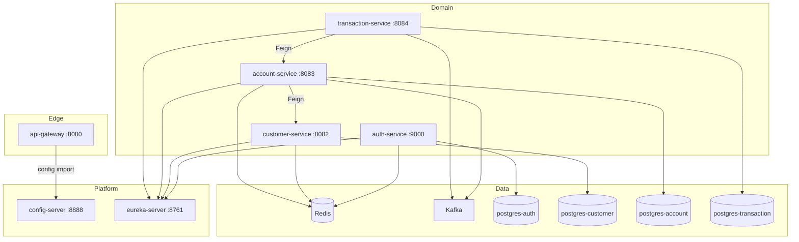
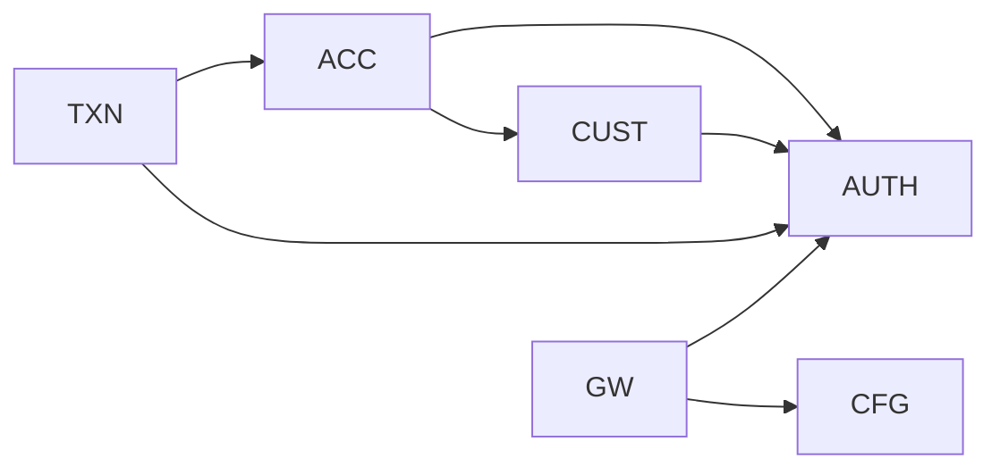
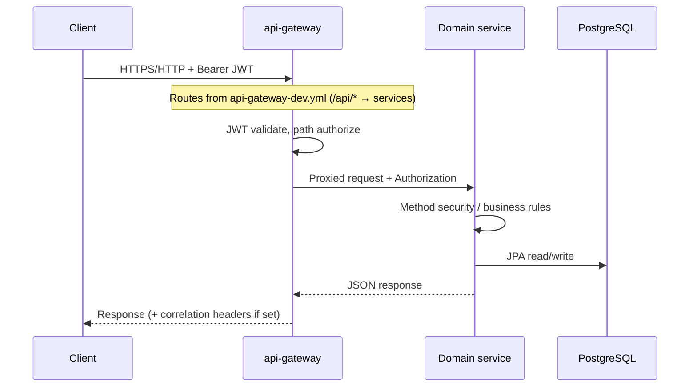

# Architecture

## Architectural style

**Microservice architecture** with:

- **Database-per-service** (four PostgreSQL instances in Compose)
- **API Gateway** as the intended edge (Spring Cloud Gateway WebFlux)
- **Service discovery** via Netflix Eureka
- **Externalized configuration** via Spring Cloud Config Server (Git)
- **Synchronous service calls** via OpenFeign (account ↔ customer, transaction ↔ account)
- **Asynchronous events** via Kafka producers (no consumers in this repository)
- **Shared JWT trust** — resource servers validate tokens using auth-service JWKS (`/oauth2/jwks`)

Reasoning supported by code: each business domain (`auth`, `customer`, `account`, `transaction`) is a separate Spring Boot app with its own port, datasource, and Dockerfile.

## High-level component architecture

## Module responsibilities

| Module | Responsibility |
|--------|----------------|
| `banking-system-parent` | Maven parent BOM: Java 21, Boot 3.4.10, Cloud 2024.0.0, shared dependency versions |
| `config-server` | Serves config from Git; HTTP Basic protected |
| `eureka-server` | Service registry (standalone; does not register itself) |
| `api-gateway` | Edge security, correlation/logging filters, rate-limit key resolver bean; routes from config server |
| `auth-service` | Users, OTP, OAuth2 AS, RBAC, login audit |
| `customer-service` | Customer CRUD-lite, KYC entity, Setu HTTP |
| `account-service` | Accounts, sequence/number generation, Redis cache/locks, Kafka produce |
| `transaction-service` | Debit/credit processing, audit, Resilience4j, Kafka produce |
| `kb/` | Partial Kubernetes manifests for namespace `banking-system` |

## Layer responsibilities (typical domain service)

Within each domain service, the code follows a conventional Spring layering:

1. **Controller** — HTTP mapping, extracts IP / `X-Device-Id` where needed
2. **Service** — business rules, orchestration, transactions
3. **Repository** — Spring Data JPA
4. **Entity / DTO** — persistence vs API models
5. **Config / Security** — filter chains, Feign interceptors, Redis/Kafka beans
6. **Client** — Feign interfaces for inter-service calls

## Dependency relationships

- JWT validation depends on `auth-service` JWKS URL configured in service YAML.
- Feign clients use Eureka service names: `customer-service`, `account-service`.
- Feign forwards the inbound `Authorization` header (`FeignSecurityConfig` in account- and transaction-service).

## Request / response lifecycle (authenticated API)

Direct service calls (bypassing gateway) are also possible on published ports; gateway is not enforced by network policy in Compose.

## Communication patterns

| Pattern | Where used |
|---------|------------|
| Sync REST (Feign) | `CustomerClient`, `AccountClient` |
| Sync REST (WebClient) | `SetuService` → Setu sandbox |
| Async Kafka produce | Account create, transaction success |
| Cache | Spring Cache + Redis (`customer-user-cache`, `account-cache`) |
| Distributed lock | Redisson in `AccountService.updateBalance` (not used by controller balance path) |

## Design patterns actually used

| Pattern | Evidence |
|---------|----------|
| API Gateway | `api-gateway` module |
| Service Registry | Eureka clients + server |
| Externalized Configuration | Config Server + `spring.config.import` on gateway |
| Resource Server | OAuth2 JWT on domain services + gateway |
| Authorization Server | Spring Authorization Server in auth-service |
| Repository | Spring Data JPA interfaces |
| DTO mapping | Manual builders in services |
| Circuit breaker / retry / bulkhead / time limiter | `AccountProtectionService` |
| Idempotency key | `referenceId` on transactions |
| Optimistic locking (prepared) | `Account.version` + Flyway column (controller path may not rely on locked service method) |

## Startup sequence (intended Compose order)

1. Redis, Postgres instances, Zookeeper/Kafka
2. `config-server`
3. `eureka-server` (depends_on config-server; does not consume config in local YAML)
4. Domain services (auth depends on postgres-auth, redis, eureka)
5. `api-gateway` (depends_on domain services; imports config)

Actual readiness/health waits are **not** configured (`depends_on` only). Kafka/Zookeeper network attachment is incomplete — see [KNOWN_ISSUES_AND_IMPROVEMENTS.md](KNOWN_ISSUES_AND_IMPROVEMENTS.md).

## Architectural limitations and improvements

1. **No saga / outbox** for account balance + transaction record consistency across services.
2. **Absolute balance update** via Feign races possible without using Redisson-locked service path.
3. **Ephemeral RSA JWK** in auth-service invalidates tokens on restart.
4. **External gateway config** reduces reproducibility of this repo alone.
5. **No Kafka consumers** — events are fire-and-forget.
6. **Parent POM typo** (`customer-server`) breaks reactor builds.
7. Prefer consolidating secrets into env/secret managers; remove plaintext from YAML and `kb/secrets`.

## Related documents

- [TECHNICAL_DOCUMENTATION.md](TECHNICAL_DOCUMENTATION.md)
- [SECURITY.md](SECURITY.md)
- [WORKFLOWS.md](WORKFLOWS.md)
