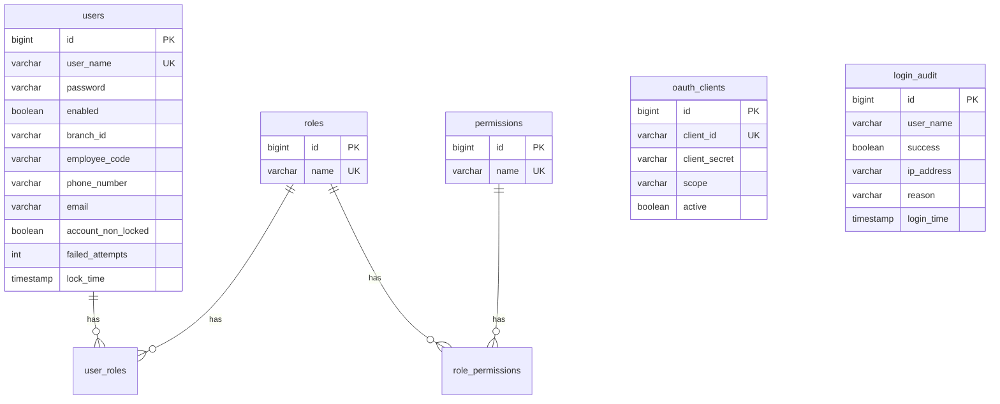
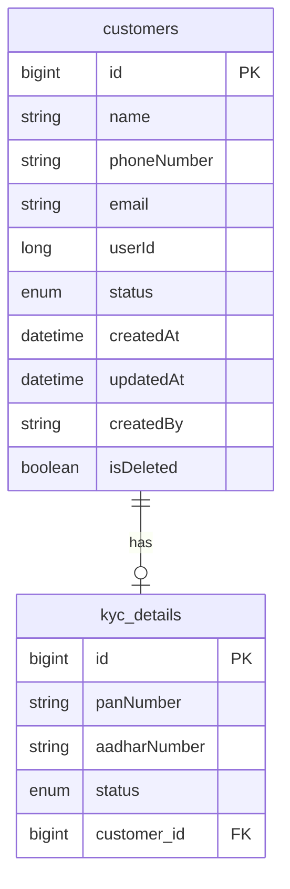
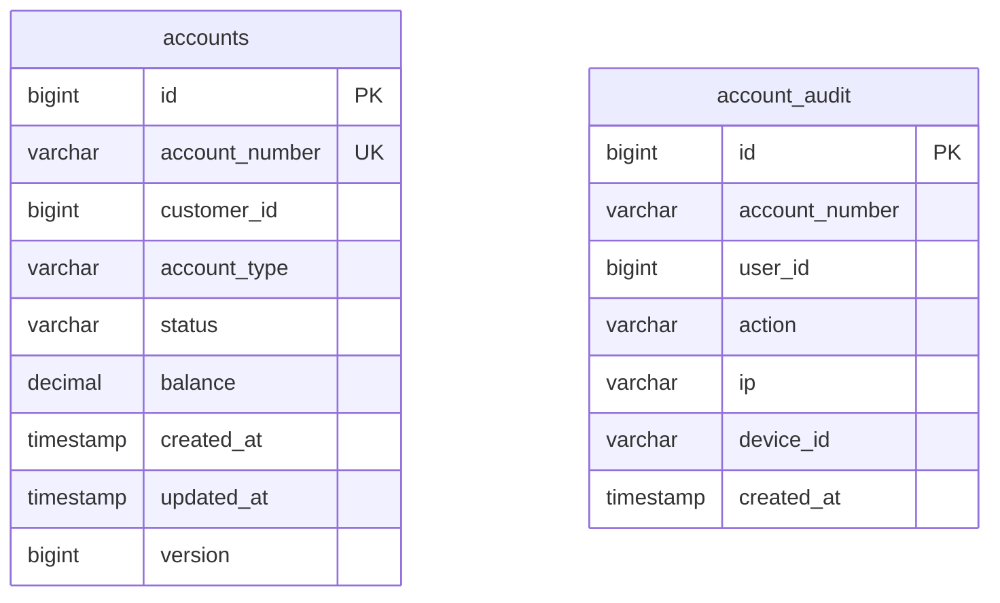
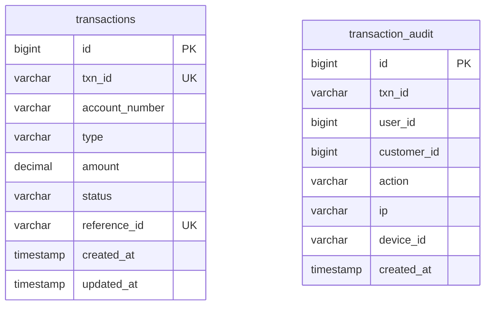

# Database Documentation

## Technology and topology

| Database (Compose) | Host port | DB name | Used by | Schema management |
|--------------------|-----------|---------|---------|-------------------|
| `postgres-auth` | 5434→5432 | `authdb` | auth-service | Flyway + `ddl-auto: validate` |
| `postgres-customer` | 5433→5432 | `customerdb` | customer-service | Hibernate `ddl-auto: update` (no Flyway) |
| `postgres-account` | 5432 | `accountdb` | account-service | Flyway + `ddl-auto: validate` |
| `postgres-transaction` | 5435→5432 | `transactiondb` | transaction-service | Flyway + `ddl-auto: validate` |

Compose sets Postgres user/password via environment variables. Service YAML credentials must match those environments (customer-service YAML currently uses different placeholder names — see [CONFIGURATION.md](CONFIGURATION.md)).

---

## authdb (verified via Flyway)

### ER diagram

### Tables

**`users`** — V1 + V3 columns. Indexes: `idx_users_username`.

**`roles`**, **`user_roles`** — many-to-many.

**`permissions`**, **`role_permissions`** — many-to-many (V2). Seed data:

- Roles: `ROLE_ADMIN`, `ROLE_BANKER`, `ROLE_CUSTOMER`
- Permissions: `CREATE_ACCOUNT`, `VIEW_ACCOUNT`, `TRANSFER_MONEY`, `APPROVE_TRNASACTION`

**`oauth_clients`** — present in schema; **runtime AS uses in-memory client**, not this table.

**`login_audit`** — index `idx_audit_username`.

### Repositories

`UserRepository`, `RoleRepository`, `PermissionRepository`, `LoginAuditRepository`, `ClientRepository` (unused at AS wiring).

---

## customerdb (inferred from JPA entities)

No migrations in repo. Hibernate `update` creates/alters tables.

### ER diagram

**Enums:** `CustomerStatus` = PENDING, ACTIVE, BLOCKED; `KycStatus` = PENDING, VERIFIED, REJECTED.

**Note:** `KycRepository.findByCustomerId(Long)` may be fragile because the entity models association `customer` rather than a scalar `customerId` field — **requires runtime verification**.

---

## accountdb (Flyway)

### Migrations

| Script | Content |
|--------|---------|
| `V1__create_account_table.sql` | `accounts` |
| `V2__create_account_sequence.sql` | `account_seq`, `account_audit` |
| `V2__add_version_column.sql` | `accounts.version` |

**Conflict:** two scripts share version `V2`. Flyway will not apply both cleanly — **confirmed issue**.

### ER diagram

**Sequence:** `account_seq` START 1000000000.

**Entity:** `Account` with `@Version` on `version`.  
**Audit entity:** `AccountAudit` → table `account_audit`.

**Integrity:** `account_number` unique; `customer_id` is a logical reference to customer-service (no cross-DB FK).

---

## transactiondb (Flyway)

| Script | Content |
|--------|---------|
| `V1__create_transaction_table.sql` | `transactions`, `transaction_audit`, index `idx_txn_account` |
| `V2__add_reference_id_unique.sql` | unique constraint on `reference_id` |

### ER diagram

### Entity mismatch (verified)

`TransactionAudit` maps to `@Table(name = "transactionAudit")` while migration creates `transaction_audit`. With `ddl-auto: validate`, startup may fail unless naming strategy remaps — **high risk; treat as bug**.

Entity also omits `customer_id` column present in SQL.

### Transaction statuses / types

Enums: `TransactionStatus` (includes PENDING, SUCCESS, FAILED — verify enum file for full set), `TransactionType` DEBIT / CREDIT.

---

## Persistence behavior notes

| Concern | Behavior |
|---------|----------|
| Cross-service FKs | None; IDs stored as scalars |
| Idempotency | Unique `reference_id` on transactions |
| Optimistic locking | `accounts.version` prepared; live Feign update path bypasses locked service method |
| Soft delete | `customers.isDeleted` |
| Redis | OTP and caches; not primary store of record |

## Important queries (code)

- Find user by username (login / UserDetails)
- Find customer by userId and not deleted
- Find account by accountNumber; `findByAccountNumberForUpdate` in locked path
- Find transaction by `referenceId` / `txnId`

Exact JPQL/method names live in the respective `*Repository` interfaces.
