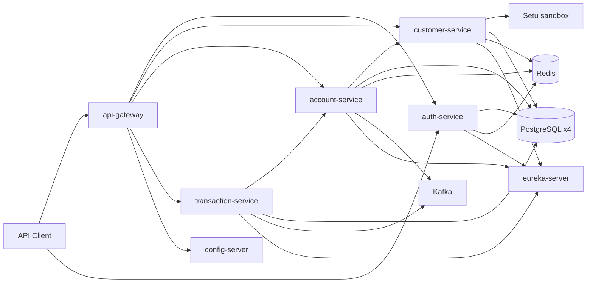

# Project Overview

## Problem statement

NeoBank provides a backend for a digital banking platform: authenticate staff/customers, onboard customers with KYC signals, open accounts, and process debit/credit movements against those accounts. The system is split into independently deployable Spring Boot services coordinated by Eureka, Config Server, Redis, Kafka, and PostgreSQL databases (database-per-service).

## Functional scope

### Implemented

1. **Identity**
   - Register users with BCrypt-hashed passwords.
   - Password login with lockout after 5 failures (15-minute lock).
   - OTP generation stored in Redis; delivery via Twilio SMS and SMTP email.
   - JWT access tokens via Spring Authorization Server custom grant `otp`.
   - Admin APIs to assign roles and permissions.

2. **Customer**
   - Create customer profile bound to JWT `userId`.
   - Internal lookup by `userId` (used by account-service).
   - KYC record persistence.
   - Setu sandbox proxies for PAN verify, DigiLocker create/status/Aadhaar fetch.

3. **Accounts**
   - Create account with generated account number (branch `4201`, type code `10`, sequence + check digit).
   - Validate minimum initial deposit (1000) and customer ACTIVE + KYC VERIFIED.
   - Internal get/update balance APIs for transaction-service.
   - Publish `account-created-topic` events.

4. **Transactions**
   - Process `DEBIT` / `CREDIT` with amount limit 50,000.
   - Idempotency by `referenceId`.
   - Reversal of successful transactions.
   - Resilience4j protection on account **read**.
   - Publish `transaction-event` on success.

5. **Platform**
   - Eureka registry, Config Server (Git), API Gateway filters/security, Docker Compose, partial K8s manifests.

### Incomplete / not implemented

| Area | Reality in code |
|------|-----------------|
| Full KYC verification | Setu verify calls in `KycService.submitKyc` are commented; flags stay `false` → status **REJECTED** |
| DigiLocker callback persistence | Logs only; does not update `kyc_details` / customer status |
| Peer-to-peer transfer | No two-account transfer workflow |
| Kafka consumers | Producers only; no `@KafkaListener` in repo |
| Account audit on create | `AccountAuditService` exists but is not called from create flow |
| Gateway routes | Verified from `api-gateway-dev.yml` (mirrored under `docs/external-config/`); auth `StripPrefix` conflicts with controllers |
| VIEW_ACCOUNT / APPROVE_TRNASACTION usage | Seeded permissions; no matching `@PreAuthorize` found on controllers |
| ELK observability | Logstash pipeline file present; Compose services commented out |

## User roles

Seeded in Flyway `auth-service` migration `V2__role_permission.sql`:

| Role | Purpose (inferred from name + admin APIs) |
|------|-------------------------------------------|
| `ROLE_ADMIN` | Access `/admin/**` on auth-service; gateway `/api/admin/**` requires `ADMIN` |
| `ROLE_BANKER` | Staff role; no dedicated method-security mappings found beyond token authorities |
| `ROLE_CUSTOMER` | End-customer role; same note |

Seeded permissions:

- `CREATE_ACCOUNT` — required for `POST /accounts`
- `VIEW_ACCOUNT` — seeded; **no controller usage verified**
- `TRANSFER_MONEY` — required for `POST /transactions` (debit/credit, not transfer)
- `APPROVE_TRNASACTION` — seeded (typo in SQL); **no controller usage verified**

New registrations do **not** automatically receive a default role (must be assigned via admin API).

## Core use cases

1. Register → admin assigns role/permissions → login → OTP → token → call APIs.
2. Authenticated user creates customer profile.
3. Submit KYC (currently rejects without live Setu verify in submit path) / use Setu proxy endpoints.
4. Create bank account when customer is ACTIVE and KYC VERIFIED.
5. Debit or credit an account; optionally reverse a successful transaction.

## Major business workflows

Documented end-to-end in [WORKFLOWS.md](WORKFLOWS.md):

- Authentication (password + OTP → JWT)
- Customer onboarding
- Account opening
- Debit / credit processing
- Transaction reversal

## Actors and systems

Gateway client paths (verified): `/api/accounts/**`, `/api/transactions/**`, `/api/customers/**`, `/api/kyc/**`, plus `/auth/**` and `/oauth2/**` (auth StripPrefix currently mismatched — see [API_DOCUMENTATION.md](API_DOCUMENTATION.md)). Clients may also call services directly on their ports.
