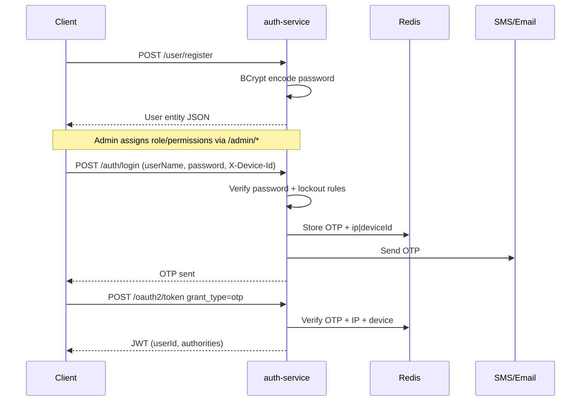
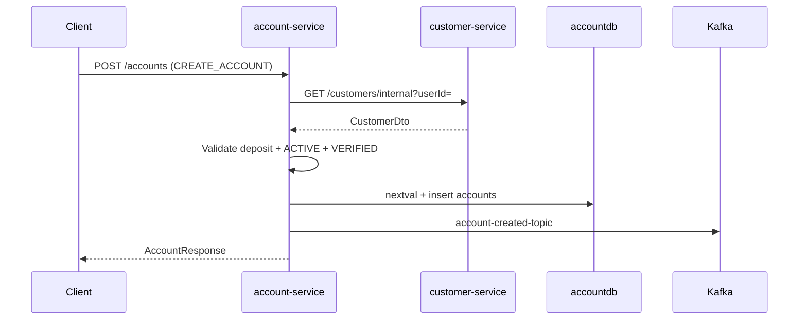
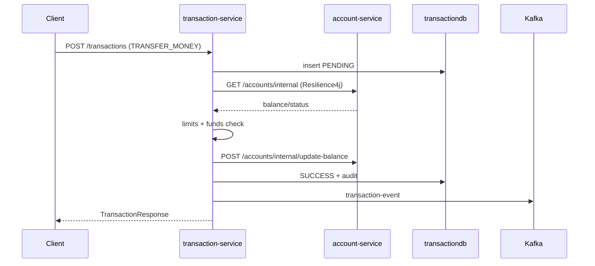

# Workflows

## 1. Registration → OTP login → JWT

1. **Entry:** `UserController` / `LoginController` / AS token endpoint  
2. **Input:** register JSON; login params; OTP + client auth  
3. **Rules:** lockout 5/15min; OTP metadata must match  
4. **Persistence:** `users`; audit optional via login-success/failure  
5. **External:** Twilio, SMTP  
6. **Success:** `"OTP sent"` then OAuth2 access token  
7. **Failure:** invalid credentials, locked account, OTP mismatch → exceptions  

---

## 2. Customer onboarding

1. **Entry:** `POST /customers` (`CustomerController`)  
2. **Input:** `name`, `phone`, `email`; JWT with `userId`  
3. **Processing:** reject if customer exists for user; status `PENDING`  
4. **DB:** insert `customers`  
5. **External:** none  
6. **Success:** `CustomerResponse`  
7. **Failure:** missing JWT claims / duplicate → `RuntimeException`  

Optional KYC:

1. **Entry:** `POST /kyc/{customerId}`  
2. **Processing:** Setu verify **commented out** → typically `REJECTED`  
3. **DB:** `kyc_details` + maybe customer status if verified path taken  
4. **Failure/partial:** DigiLocker callback does not persist Aadhaar  

---

## 3. Account opening

1. **Entry:** `AccountController.create`  
2. **Input:** `accountType`, `intialDeposit`; JWT  
3. **Rules:** deposit ≥ 1000; customer ACTIVE; KYC VERIFIED  
4. **Interactions:** Feign customer-service  
5. **DB:** `account_seq`, `accounts`  
6. **External:** Kafka produce  
7. **Success:** account number + balance + status  
8. **Failure:** validation / Feign / customer missing  

**Gap:** audit IP/device not persisted despite parameters.

---

## 4. Debit / credit (single account)

1. **Entry:** `TransactionController.transact`  
2. **Input:** `referenceId`, `accountNumber`, `amount`, `type`  
3. **Rules:** idempotent `referenceId`; amount ≤ 50000; not BLOCKED; debit ≤ balance  
4. **Interactions:** Feign account GET (protected) + balance update (unprotected)  
5. **DB:** `transactions`, audit table  
6. **External:** Kafka on success  
7. **Success:** `SUCCESS` response  
8. **Failure:** mark `FAILED`, audit failure, throw  

**Not a peer-to-peer transfer** despite authority name.

---

## 5. Transaction reversal

1. **Entry:** `POST /transactions/reverse/{txnId}`  
2. **Input:** path `txnId`; JWT (any authenticated)  
3. **Rules:** existing txn must be `SUCCESS`  
4. **Processing:** flip DEBIT↔CREDIT; call `process` with ip=`System`, device=`reversal`  
5. **DB/Kafka:** same as debit/credit path  
6. **Failure:** not found / not SUCCESS  

---

## 6. Gateway-mediated call (verified routes)

1. Client → api-gateway `:8080` with Bearer token (except public paths)  
2. Gateway validates JWT via `jwk-set-uri` from `api-gateway-dev.yml`  
3. Global `RequestRateLimiter` (Redis) + correlation/logging filters  
4. Route examples:
   - `/api/accounts/**` → `lb://ACCOUNT-SERVICE` → `/accounts/**`
   - `/api/transactions/**` → `lb://TRANSACTION-SERVICE` → `/transactions/**` (CircuitBreaker → `/fallback/transaction` if open; **fallback handler missing in code**)
   - `/api/customers/**`, `/api/kyc/**` → `lb://CUSTOMER-SERVICE` → `/customers/**`, `/kyc/**`
   - `/auth/**`, `/oauth2/**` → `lb://AUTH-SERVICE` with `StripPrefix=1` (**mismatched**; prefer calling auth-service `:9000` directly until fixed)
5. Service executes domain logic  

If config server is unavailable (`optional:` import), gateway may start without these routes.
